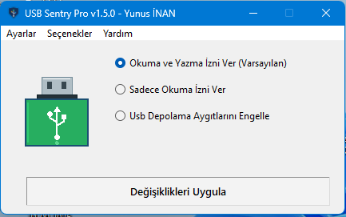
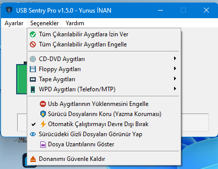
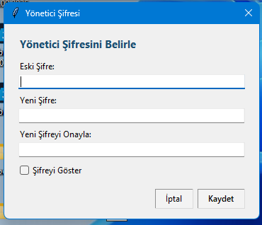
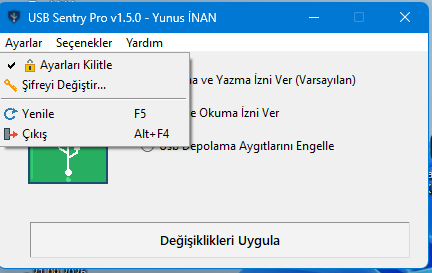
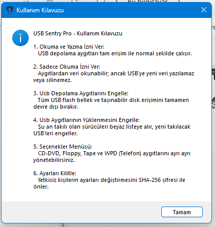
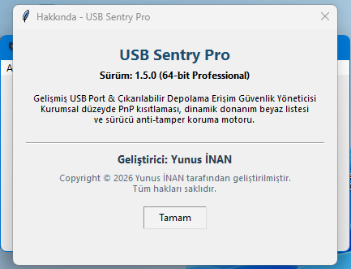

# USB Sentry Pro (v1.5.0)

[](https://github.com/Terabithia1572/USBSentryPro/releases)
[](https://github.com/Terabithia1572/USBSentryPro)
[](https://www.python.org/)
[](https://github.com/Terabithia1572/USBSentryPro)
[](https://github.com/Terabithia1572/USBSentryPro)

**Enterprise-grade Windows USB port and removable storage access control utility developed natively using Win32 API, SetupAPI, and Windows Registry policy enforcement.**

Developed exclusively by **Yunus İNAN**.  
*Copyright © 2026 Yunus İNAN. Tüm hakları saklıdır.*

---

## 📌 Executive Overview

**USB Sentry Pro** is an advanced endpoint security utility engineered to protect Windows environments against unauthorized removable media, malicious physical intrusions (BadUSB / Rubber Ducky), and sensitive corporate data leakage (Data Loss Prevention - DLP).

Unlike naive tools that only alter the standard `Start` DWORD in the `USBSTOR` service, **USB Sentry Pro** employs a multi-layered security engine that interacts directly with:
- **Windows PnP Device Manager (`SetupAPI`)**
- **Kernel Device Installation Group Policy Subsystems (`DeviceInstall\Restrictions`)**
- **Hardware ID Snapshot & Whitelisting (`AllowDeviceIDs` / `DenyDeviceIDs`)**
- **Registry DACL Hardening (`HKLM\SYSTEM\CurrentControlSet\Enum\USBSTOR`)**
- **NTFS Discretionary Access Control Lists (`icacls` on `usbstor.inf` & `usbstor.pnf`)**
- **Cryptographic Master Password Authentication (`SHA-256` with 16-byte random salt)**

---

## 🖼️ Visual Showcase

| Ana Kontrol Paneli & Durum Göstergesi | Seçenekler & Genişletilmiş Çevre Birimleri |
| :---: | :---: |
|  |  |
| **Yönetici Giriş Doğrulaması** | **Ayarlar & Şifre Yönetimi** |
|  |  |
| **Bağlı Aygıt Bilgisi (WMI / PnP)** | **Hakkında & Geliştirici Bilgisi** |
|  |  |

---

## 🛡️ Key Features

### 1. 3-Tier Core USB Access Policy
- 🔓 **Tüm Aygıtlara İzin Ver (Varsayılan):** Normal Windows USB depolama işlevi. Okuma ve yazma operasyonları kısıtlama olmaksızın çalışır.
- 🟡 **Sadece Okunabilir Yap (Yazma Koruması):** `HKLM\SYSTEM\CurrentControlSet\Control\StorageDevicePolicies\WriteProtect = 1` politikası uygulanır. USB sürücülerden veri okunabilir ancak sürücüye dosya kopyalanamaz, değiştirilemez veya silinemez.
- 🚫 **Usb Depolama Aygıtlarını Engelle:** `USBSTOR` servis başlangıcı `Start = 4` yapılarak tüm USB depolama birimleri anında devre dışı bırakılır.

### 2. Dinamik Donanım Kimliği Beyaz Listeleme & PnP Devnode Kilidi
- **Aktif Sürücüleri Canlı Tutma:** Özellik etkinleştirildiği anda halihazırda bağlı bulunan yetkili USB sürücülerin PnP Donanım Kimlikleri (`Hardware IDs`) anlık olarak taranır ve `HKLM\SOFTWARE\Policies\Microsoft\Windows\DeviceInstall\Restrictions\AllowDeviceIDs` tablosuna yazılır.
- **PnP Devnode Karantinası (`ConfigFlags = 1`):** `HKLM\SYSTEM\CurrentControlSet\Enum\USBSTOR` altındaki daha önce takılmış ancak o an bağlı olmayan tüm yabancı aygıt kayıtlarına `ConfigFlags = 1` (`CONFIGFLAG_DISABLED`) atanır. Windows PnP yöneticisi önbellekteki aygıtları yeniden aktifleştiremez.
- **Kayıt Defteri DACL Dondurma:** `Enum\USBSTOR` anahtarının erişim izinleri dondurularak `SYSTEM` ve kullanıcı hesaplarının yeni devnode eklemesi veya kilitleri kaldırması engellenir.
- **Kapsamlı Engelleme Politikası:** `DenyDeviceIDs = 1` ve `USBSTOR\*` wildcard engellemesi devreye alınır; yalnızca beyaz listedeki kimliklere izin verilir.

### 3. INF Sürücü Dosyası Kilitleme (NTFS DACL Hardening)
- `%SystemRoot%\inf\usbstor.inf` ve `usbstor.pnf` çekirdek sürücü tanımlama dosyalarının sahipliği `takeown` ile devralınır.
- `icacls` kullanılarak `SYSTEM`, `Administrators` ve `Users` gruplarının bu dosyalar üzerindeki okuma/yürütme izinleri kısıtlanır, böylece Windows yeni bir USB bellek için sürücü yükleyemez.

### 4. Kriptografik Yönetici Şifresi & Başlangıç Kilit Ekranı
- **Salted SHA-256:** Yönetici şifresi düz metin olarak değil, 16 baytlık kriptografik rastgele tuz (`os.urandom(16)`) ile SHA-256 hash'i alınarak `%USERPROFILE%\.usbsentrypro\config.json` dosyasında saklanır.
- **In-Window Modal Lock Screen:** Ayarlar kilitliyken uygulama başlatıldığında, ana pencere arayüzü ve menü çubuğu kilitlenir; 3 hatalı deneme hakkı tanınan yönetici doğrulama ekranı gösterilir. Doğrulama başarılı olmadan hiçbir ayara erişilemez.

### 5. Genişletilmiş Çevre Birimleri & Sistem Güvenliği
- **Optik Medya (CD/DVD):** Sınıf GUID'i `{99042d36-02da-4f59-a084-21e1a50e4483}` üzerinden Okuma/Yazma, Salt Okunur veya Tam Bloklama.
- **Disket Sürücüler (Floppy):** GUID `{53f56311-b6bf-11d0-94f2-00a0c91efb8b}` politikası.
- **Manyetik Teyp Birimleri (Tape):** GUID `{53f5630b-b6bf-11d0-94f2-00a0c91efb8b}` politikası.
- **Mobil Cihazlar & MTP (WPD):** GUID `{6ac27878-a641-4228-bacf-0a4d86444588}` üzerinden akıllı telefon ve medya cihazlarını engelleme.
- **Zararlı Yazılım Önleme (AutoRun):** `NoDriveTypeAutoRun` kayıt defteri anahtarı ile otomatik çalıştırma zararlılarına karşı bağışıklık.
- **Dosya Görünürlük Kontrolleri:** Gizli dosyaları ve dosya uzantılarını tek tıkla görünür yapma araçları.

### 6. Sıfır Bağımlılık & Taşınabilir Yapı
- Tek dosya bağımsız ikili (`USBSentryPro.exe` - 31.9 MB), sistemde Python veya harici kütüphane kurulu olmasını gerektirmez.
- Windows Administrator (UAC `requireAdministrator`) bildirimi doğrudan manifest içine gömülüdür.
- Profesyonel Inno Setup 6 kurulum paketi (`USBSentryPro_v1.5.0_Setup.exe` - 33.4 MB) ile kurumsal dağıtım desteği.

---

## 🏛️ Mimari & Teknoloji Yığını

```
┌──────────────────────────────────────────────────────────────────┐
│                     USB Sentry Pro UI (v1.5.0)                   │
│         Native Win32 Menus | Pillow 16x16 RGBA Simgeler          │
│               Pixel-Perfect 105x105 Canvas Durum Çizimi          │
└─────────────────────────────────┬────────────────────────────────┘
                                  │
      ┌───────────────────────────┼───────────────────────────┐
      ▼                           ▼                           ▼
┌──────────────┐          ┌──────────────┐          ┌──────────────────┐
│  Auth Engine │          │ Policy Core  │          │ Security Storage │
│ Salted SHA256│          │ Win32 API    │          │ Win32 Registry   │
│ In-Window UI │          │ SetupAPI     │          │ HKLM Policies    │
└──────────────┘          └───────┬──────┘          └──────────────────┘
                                  │
    ┌─────────────────────────────┼─────────────────────────────┐
    ▼                             ▼                             ▼
┌────────────────────────┐  ┌────────────────────────┐  ┌────────────────────────┐
│ PnP Devnode Lockdown   │  │ Hardware ID Whitelist  │  │ Driver DACL Hardening  │
│ Enum\USBSTOR DACL      │  │ AllowDeviceIDs Snapshot│  │ takeown & icacls on    │
│ ConfigFlags = 1 Quaran.│  │ DenyDeviceIDs = 1      │  │ usbstor.inf / .pnf     │
└────────────────────────┘  └────────────────────────┘  └────────────────────────┘
```

| Bileşen | Teknoloji | Açıklama |
| :--- | :--- | :--- |
| **Dil & Çalışma Zamanı** | Python 3.12 (x64) | Standart kütüphane odaklı, optimize mimari |
| **Grafik Arayüz (GUI)** | Tkinter / Tcl 8.6 | Yerel Win32 stilinde, yüksek DPI duyarlı arayüz |
| **Grafik & Simgeler** | Pillow (PIL) 12.3.0 | Bellek içi 16x16 RGBA dinamik ikon üretimi |
| **Sistem API Entegrasyonu**| `winreg`, `ctypes`, `subprocess` | Windows Registry, Shell32, SetupAPI, Advapi32 |
| **Derleme & Paketleme** | PyInstaller 6.22.3 | `--windowed --onefile --uac-admin` (Konsolsuz) |
| **Kurulum Sihirbazı** | Inno Setup 6.6.0 | Modern UI, LZMA2 ultra sıkıştırma, Türkçe/İngilizce |

---

## 🚀 Kurulum & Çalıştırma

### Yöntem 1: Standalone Çalıştırılabilir Dosya (Önerilen)
1. [Releases](https://github.com/Terabithia1572/USBSentryPro/releases) sayfasından `USBSentryPro.exe` dosyasını indirin.
2. Dosyayı doğrudan çalıştırın (UAC yönetici onayı verin).
3. Kurulum gerektirmez, flash bellek üzerinden taşınabilir olarak çalıştırılabilir.

### Yöntem 2: Kurulum Sihirbazı (Inno Setup)
1. `USBSentryPro_v1.5.0_Setup.exe` dosyasını indirin ve çalıştırın.
2. Kurulum sihirbazı adımlarını takip ederek uygulamayı `Program Files\USBSentryPro` dizinine kurun.
3. Masaüstü ve Başlat Menüsü kısayollarından tek tıkla başlatın.

### Yöntem 3: Kaynak Koddan Çalıştırma
```powershell
# Depoyu klonlayın
git clone https://github.com/Terabithia1572/USBSentryPro.git
cd USBSentryPro

# Gereksinimleri yükleyin
pip install pillow

# Yönetici olarak çalıştırın
python usb_sentry.py
```

---

## 👤 Geliştirici & Telif Hakkı

Bu yazılım baştan sona **Yunus İNAN** tarafından tasarlanmış, geliştirilmiş ve test edilmiştir.

- **Geliştirici:** Yunus İNAN
- **E-posta:** legendys65@gmail.com
- **GitHub:** [@Terabithia1572](https://github.com/Terabithia1572)
- **Telif Bildirimi:** Copyright © 2026 Yunus İNAN. Tüm hakları saklıdır.
